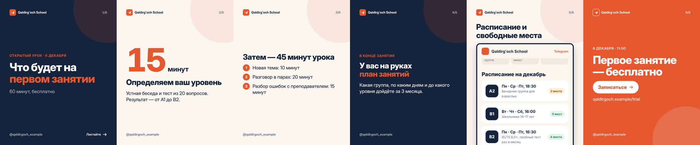

# growth-studio

Открытые навыки и инструменты для ИИ-агента (Claude Code), два набора. Каждый набор — отдельный
плагин, оба ставятся из этого репозитория.

**Рост** (плагин `growth-studio`): исследовать рынок и вести маркетинг из одной папки.

- **навык роста** — исследование конкурентов и рынка по открытым данным, шаг за шагом; у каждой находки источник и пометка «видели» или «предполагаем»;
- **инструменты производства** — посты, карусели, сторис и вертикальные рилсы со звуком: из текстового сценария одной командой;
- **контент-план, UTM-ссылки и еженедельный отчёт**, чтобы заявки приходили в CRM с источником.

**Дизайн** (плагин `design-skills`): «сделай красиво» и «сделай понятно» превращаются в правила,
которые проверяются по снимку экрана.

- **ux-clarity** — поймёт ли новый пользователь экран с первого раза, с телефона, без объяснений: 69 правил и аудит из 54 вопросов с баллом;
- **ui-craft** — ровно ли сделан экран и силён ли он: измеримые правила отступов, выравнивания, типографики и раскладки на четырёх ширинах, а также композиция, данные, цвет в рамках бренда и рубрика «уровень лучших»;
- **скрипт измерений** для любого адреса или HTML-файла, команды аудита и агент-оценщик только для чтения.

English: [README.md](README.md).



Продукты во всех примерах вымышленные. Превью — в [`examples/`](examples/).

## Установка плагинов в Claude Code

```
/plugin marketplace add doossee/growth-studio
/plugin install growth-studio@growth-studio
/plugin install design-skills@growth-studio
```

Ставьте один плагин или оба. В Claude Code 2.1.275 и новее каждый плагин ставится и одной командой:
`/plugin install design-skills --marketplace doossee/growth-studio`. Из терминала:
`claude plugin marketplace add doossee/growth-studio && claude plugin install design-skills@growth-studio`.

| Плагин | Что добавляет | Как вызвать |
|---|---|---|
| `growth-studio` | навык `growth` | `/growth-studio:growth`, или Claude подключает его сам, когда вы просите исследование |
| `design-skills` | навыки `ui-craft`, `ux-clarity` | загружаются сами, когда проектируете, верстаете или проверяете экран; или `/design-skills:ui-craft`, `/design-skills:ux-clarity` |
| | команды `ui-audit`, `ux-audit`, `design-variants` | `/design-skills:ui-audit <адрес>`, `/design-skills:ux-audit <адрес>`, `/design-skills:design-variants <экран>` |
| | агент `design-judge` | его вызывают команды; или `@agent-design-skills:design-judge` |

Каждый плагин загружает только свои папки. Попробовать локальную копию без установки:
`claude --plugin-dir /путь/к/growth-studio` — оба набора загрузятся одним плагином `growth-studio`.

Обычными навыками, без системы плагинов: скопируйте папки навыков в `.claude/skills/` (см.
[Как подключить навык роста](#как-подключить-навык-в-claude-code) и
[Навыки дизайна обычными навыками](#обычными-навыками)).

# Рост

## Чем отличается

Обычные инструменты роста рассчитаны на английский язык, крупные сайты и западные площадки. Этот набор сделан для того, что они пропускают.

**Telegram**

- читает публичные каналы через `t.me/s/<канал>` без входа и ключей: подписчики, ритм, медиана просмотров, лучшие посты — [`skills/growth/scripts/tg-channel.mjs`](skills/growth/scripts/tg-channel.mjs);
- методика для чатов, каталогов и открытой статистики каналов, рекламных постов, ботов — [`references/telegram.md`](skills/growth/references/telegram.md);
- ссылки для ботов: источник передаётся в параметре `/start`, куда UTM-метки не доходят;
- публикация в канал через бота.

**Центральная Азия и СНГ**

- тексты на нескольких языках из одного сценария: узбекский (латиница), русский, казахский и другие; правильные узбекские `oʻ`, `gʻ`; шрифт с полной кириллицей;
- местные карты и площадки в шагах исследования: Yandex Maps, 2GIS, доски объявлений, маркетплейсы, сайты вакансий;
- методика для маленьких сайтов, по которым у платных сервисов аналитики нет данных, — [`references/central-asia.md`](skills/growth/references/central-asia.md).

## Быстрый старт

Нужны **Node.js 20+** и **ffmpeg** (для рилсов). Python не нужен.

```bash
# macOS
brew install node ffmpeg

# Ubuntu / Debian (если в дистрибутиве Node старше 20 — поставьте из NodeSource или через nvm)
sudo apt update && sudo apt install -y nodejs npm ffmpeg
```

```bash
git clone https://github.com/doossee/growth-studio.git
cd growth-studio
npm install
npx playwright install chromium          # Linux: npx playwright install --with-deps chromium

npm run post     -- examples/scenarios/post-trial.yaml             # → out/post-trial/<язык>/post-trial.png
npm run carousel -- examples/scenarios/carousel-first-lesson.yaml  # → out/carousel-first-lesson/<язык>/01.png …
npm run story    -- examples/scenarios/story-reminder.yaml         # → PNG 1080×1920
npm run reel     -- examples/scenarios/reel-open-day.yaml          # → out/reel-open-day/reel-open-day.<язык>.mp4
```

Всё пишется в `out/` — эта папка в git не попадает. `npm run examples` пересобирает все примеры и превью.

| Команда | Что делает | Подробнее |
|---|---|---|
| `npm run post -- <сценарий>` | пост 1080×1350 или 1080×1080 | [tools/cards](tools/cards/README.md) |
| `npm run carousel -- <сценарий>` | карусель, 2–10 слайдов | [tools/cards](tools/cards/README.md) |
| `npm run story -- <сценарий>` | сторис 1080×1920 | [tools/cards](tools/cards/README.md) |
| `npm run handout -- <сценарий>` | раздаточный листок A4 с QR, PNG + PDF | [tools/cards](tools/cards/README.md) |
| `npm run reel -- <сценарий>` | рилс 1080×1920 с музыкой, голос по желанию | [tools/reel](tools/reel/README.md) |
| `npm run utm -- --source telegram --content post_1` | UTM-ссылка и ссылка на Telegram-бота | [tools/utm](tools/utm/README.md) |
| `npm run plan -- init --out plan.yaml` / `render plan.yaml` | контент-план на 4 недели → Markdown + CSV | [tools/plan](tools/plan/README.md) |
| `npm run report -- <week.csv>` | отчёт за неделю: охват, заявки по UTM, стоимость заявки | [tools/metrics](tools/metrics/README.md) |
| `npm run tg:channel -- <канал>` | цифры публичного Telegram-канала | [telegram.md](skills/growth/references/telegram.md) |
| `npm run tg:post -- --chat @канал …` | пост в свой канал через бота (без `--send` ничего не отправляет) | [tools/publish](tools/publish/README.md) |

Все команды принимают `--profile <путь>`.

## Навык роста

`skills/growth/` работает по шагам. После каждого шага навык показывает находку и источник, ставит
пометку **«видели»** (есть ссылка или снимок), **«предполагаем»** (вывод) или **«не увидели»**
(источник не открылся — навык просит снимок экрана, а не додумывает), говорит, что с этим
делать, и ждёт «дальше / пропустить / стоп».

| Режим | Результат |
|---|---|
| (а) разбор конкурента или примера | что он делает, откуда растёт, какие приёмы работают |
| (б) разбор рынка: город или страна + ниша | кто есть, где они, что публикуют, какая реклама идёт |
| (в) «что повторить у нас» | 10 приёмов с доказательствами и план на 14 дней по каналам |
| (г) «событие» | выступление на 5–7 минут, тезисы на страницу, листок с QR, вопросы аудитории, питч у стенда на 30 секунд |

Источники бесплатные и открытые: сайт, Meta Ad Library, то, что видно без входа в Instagram и
Facebook, публичные Telegram-каналы и открытая статистика каналов, поиск Google, ответы
ИИ-ассистентов, отзывы и карты, вакансии и новости. Платные источники — только с вашим ключом,
переданным через переменную окружения.

Демо: [разбор публичной компании](examples/growth-demo/competitor-duolingo.md),
[шаг по Telegram на крупном публичном канале](examples/growth-demo/tg-telegram.md).

### Как подключить навык в Claude Code

Три способа, выберите один.

**1. Плагин** — см. [Установка плагинов](#установка-плагинов-в-claude-code):

```
/plugin marketplace add doossee/growth-studio
/plugin install growth-studio@growth-studio
```

Навык будет доступен как `/growth-studio:growth`; Claude также подключает его сам, когда вы просите
исследование.

**2. Копия** папки в проект или в домашний каталог:

```bash
mkdir -p .claude/skills && cp -r /путь/к/growth-studio/skills/growth .claude/skills/     # этот проект
mkdir -p ~/.claude/skills && cp -r /путь/к/growth-studio/skills/growth ~/.claude/skills/ # все проекты
```

**3. Ссылка**, чтобы навык обновлялся вместе с `git pull`:

```bash
mkdir -p ~/.claude/skills && ln -s /путь/к/growth-studio/skills/growth ~/.claude/skills/growth
```

Дальше — команда `/growth` или просьба обычными словами: «разбери по шагам, откуда <конкурент> берёт клиентов».
Папка навыка самодостаточна (скрипту для Telegram нужен только Node 18+); инструменты производства
используются, если репозиторий под рукой.

## Свой профиль

Профиль задаёт продукт, аудиторию, рынок, языки и бренд. В ядре нет привязки к какому-либо продукту.

1. Скопируйте `profiles/example/` куда угодно. Профиль не обязан лежать в этом репозитории, а для настоящего бизнеса и не должен: держите его в своём приватном репозитории.
2. Отредактируйте `profile.yaml`: продукт, аудитория, страна и город, языки (`uz-Latn`, `ru`, `kk`…), каналы, цвета, шрифты, логотип, ссылки и UTM по умолчанию. Описание полей: [`references/profile.md`](skills/growth/references/profile.md).
3. Передайте путь: `--profile /путь/к/профилю` или `export GROWTH_PROFILE=/путь/к/профилю`.

```bash
npm run post -- my-post.yaml --profile ~/work/my-product/growth-profile
```

Внутри этого репозитория инструменты без указания профиля берут `profiles/example` и сообщают об этом; в другом месте — нейтральные настройки. Навык без профиля задаёт четыре коротких вопроса и работает.

## Честно об ограничениях

- **Публикация.** В Telegram-канал можно публиковать через бота. У Instagram есть официальный API, но для него нужны профессиональный аккаунт, приложение Meta и медиа по публичной ссылке; большинству небольших компаний проще загружать вручную через Meta Business Suite. Подробно: [docs/publishing.md](docs/publishing.md).
- **Музыка.** По умолчанию дорожка создаётся кодом и лицензии не требует. Любая другая дорожка должна быть записана в манифест с источником и лицензией — иначе сборка останавливается. Какие библиотеки подходят: [docs/music.md](docs/music.md).
- **Голос.** По желанию. Варианты для узбекского, русского и казахского с лицензиями и ценами: [docs/voice.md](docs/voice.md). Без голоса рилс собирается с музыкой и крупными подписями.
- **Исследование.** Часть источников агенту не открывается (Meta Ad Library, счётчики Instagram). Навык говорит об этом прямо и просит снимок экрана, а не додумывает.
- **Движение в рилсах.** Playwright и ffmpeg, не Remotion — чтобы компания любого размера могла запускать без покупки лицензии. Доводы: [docs/reels.md](docs/reels.md).

# Дизайн

Описания навыков: [ui-craft](skills/ui-craft/README.ru.md), [ux-clarity](skills/ux-clarity/README.ru.md).

## Чем отличаются

- **У каждого правила есть число.** Раздел «Как измерить» содержит пиксели или вопрос «да / нет» по снимку. Правило, которое нельзя проверить, переписывают.
- **Скрипт меряет любой адрес или HTML-файл.** Девять стоп-пунктов вида, счётная часть чек-листа понятности, снимки с красными рамками нарушений, размытый снимок-«прищур», показатели композиции.
- **Всё проектное лежит в профиле.** Шкалы, бренд, языки, компоненты, вкус владельца и сознательные отступления навык читает из `design-profile.md`. Без профиля навыки работают на значениях по умолчанию и прямо говорят об этом.
- **Автор не оценивает себя сам.** Оценку рубрики для отчёта ставит оценщик в свежем контексте, который видит только снимки.

## Установка

### Плагином (рекомендуется)

```
/plugin marketplace add doossee/growth-studio
/plugin install design-skills@growth-studio
```

Что добавляет плагин:

| Что | Как вызвать | Что делает |
| --- | --- | --- |
| навык `ui-craft` | загружается сам, когда проектируешь, верстаешь или проверяешь экран; или `/design-skills:ui-craft` | правила, чек-лист, рубрика, скрипт измерений |
| навык `ux-clarity` | загружается сам; или `/design-skills:ux-clarity` | правила, чек-лист, скрипт измерений |
| команда `/design-skills:ui-audit <адрес>` | вручную | меряет страницу на 1440/1280/1024/390, проходит чек-лист, пишет `ui-audit.md` |
| команда `/design-skills:ux-audit <адрес>` | вручную | меряет на 1440 и 390, проходит 54 вопроса, пишет `ux-audit.md` |
| команда `/design-skills:design-variants <экран>` | вручную | режим свободы: 2–3 варианта с названной осью, измерены и оценены вслепую |
| агент `design-judge` | его вызывают команды; или `@agent-design-skills:design-judge` | оценщик только для чтения: ставит баллы рубрики по снимкам, без истории сборки |

### Обычными навыками

Скопируйте папки в проект (или в `~/.claude/skills/`, чтобы навыки работали во всех проектах):

```bash
git clone https://github.com/doossee/growth-studio
mkdir -p ваш-проект/.claude/skills ваш-проект/.claude/agents
cp -r growth-studio/skills/ui-craft growth-studio/skills/ux-clarity  ваш-проект/.claude/skills/
# по желанию: команды аудита и оценщик
cp -r growth-studio/skills/ui-audit growth-studio/skills/ux-audit growth-studio/skills/design-variants  ваш-проект/.claude/skills/
cp growth-studio/agents/design-judge.md  ваш-проект/.claude/agents/
```

Каждая папка навыка самодостаточна: правила, чек-лист, скрипт, примеры.

### Скрипт измерений

Нужны Node 20+ и Playwright. Если Playwright уже стоит в проекте или глобально, больше ничего не нужно. Иначе один раз для каждого навыка:

```bash
cd skills/ui-craft/scripts && npm install && npx playwright install chromium
```

## Как измерить страницу

```bash
# вид: стоп-пункты, показатели композиции, снимки с рамками и «прищур»
node skills/ui-craft/scripts/measure.mjs https://example.com
node skills/ui-craft/scripts/measure.mjs http://localhost:3000/orders --widths 1440,390 --out audit/orders

# понятность: цели касания, прокрутка вбок, мелкий текст, главные кнопки, обрезанные подписи
node skills/ux-clarity/scripts/measure.mjs http://localhost:3000/orders

# примеры из пакета: чистый экран и тот же экран с нарушением на каждый стоп-пункт и каждую метку композиции
node skills/ui-craft/scripts/measure.mjs skills/ui-craft/examples/acme-today-good.html skills/ui-craft/examples/acme-today-bad.html \
  --profile skills/ui-craft/examples/design-profile.md
```

Первая команда пишет в `ui-measure/<ширина>/`:

- `<имя>.png` — окно;
- `<имя>-full.png` — вся страница;
- `<имя>-marks.png` — красные рамки нарушений, буква на рамке означает правило;
- `<имя>-squint.png` — «прищур»;
- `metrics.json` — числа.

Сводка по всем ширинам — `ui-measure/summary.json`.

```
 1440  acme-today-good: 0 stops
 1440  acme-today-bad: 22 stops (text-edge 3, box-edge 1, clipped 1, off-scale 6, row-align 1, font-scale 4, line-length 1, state-shift 5); composition: no-hero, equal-cards, multi-primary, numbers-not-tabular, uneven-gaps, ragged-rows
```

Экран за входом, в окне или на вкладке:

- готовая сессия: `--storage-state state.json` или `--cookie имя=значение`;
- действия по порядку: `--fill 'селектор=текст'`, `--click 'селектор'`, `--wait-for 'селектор'`, `--press Escape`.

`--strict` завершает скрипт с кодом 1 при любом стоп-пункте. Все параметры показывает `--help`. Каждое число объяснено в `skills/ui-craft/references/11-measure.md`.

## Профиль дизайна

Положите `design-profile.md` в корень проекта (или в `.claude/`, или в `docs/`). В шапке — числа для скрипта, в тексте — сведения для агента:

```markdown
---
name: Acme Orders
spacing: [4, 8, 12, 16, 24, 32, 48, 64]
fonts: [12, 14, 16, 18, 20, 24, 28, 30]
hero-fonts: [36, 40, 48]
primary: "--primary"
main: "main"
languages: [en, de]
---
## Product      кто пользуется, устройство, ежедневные действия, привычные приложения
## Brand        роли цветов, шрифты, радиусы, движение (или ссылка на ваш документ о дизайне)
## Languages    какой язык самый длинный; списки слов
## Components   где лежит библиотека компонентов
## Taste        что выбрал и что отклонил тот, кто принимает дизайн
## Decisions    сознательные отступления, которые нельзя «исправлять»
## Domain examples   ваши экраны по родам, худшие данные для проверки
```

Полный формат — `skills/ui-craft/profile.md`. Готовый пример — `skills/ui-craft/examples/design-profile.md`. Профиль можно писать на языке команды.

Профиля нет? Навыки берут шкалу и пороги по умолчанию, аудиторию определяют по экрану и начинают каждый отчёт с этого факта.

Профиль дизайна — отдельный файл, не профиль роста (`profile.yaml`): один описывает экраны, другой — маркетинг.

## Как навыки работают вместе

1. `ux-clarity`: что на экране и в каком порядке. Сначала строка об экране (кто, устройство, главный вопрос, главное действие), затем правила, затем чек-лист.
2. `ui-craft`: как экран устроен и как стоит. Замысел до кода, сборка на 1440 → 1280 → 1024 → 390, взгляд до чисел, скрипт, чек-лист, рубрика.
3. Фильтр шаблонного «ИИ-вида», навык стиля текстов или доступности, если они у вас есть, идут после этих двух.

Бренд навыки не меняют: цвета, шрифты и радиусы берутся из профиля.

Тексты навыков написаны по-английски: так их может использовать любой проект. Примеры — на вымышленном продукте Acme Orders, английский плюс немецкий как язык с длинными словами.

## Ограничения

- Скрипт работает только в Chromium.
- Меряется то, что есть в DOM: canvas, текст на картинках и содержимое iframe не видны.
- Смысл скрипт не меряет. Называет ли кнопка результат и стоит ли рядом с числом нужное сравнение — это вопросы чек-листа, на них отвечают по снимкам.
- Числа по умолчанию рассчитаны на экраны программ: панели, сводки, формы. Для лендингов задайте в профиле `hero-numbers-only: false` и свою шкалу `fonts`.

## Источники

Правила написаны своими словами. У каждого указаны источники: стандарты, руководства платформ, исследования, статьи. Списки со ссылками и с утверждениями, которые проверили и не подтвердили, — в `references/sources.md` каждого навыка.

# Репозиторий

## Что где лежит

```
.claude-plugin/      marketplace.json: каталог обоих плагинов
skills/growth/       навык роста: SKILL.md, references/, templates/, scripts/
skills/ui-craft/     вид экранов: SKILL.md, profile.md, checklist.md, rubric-best.md, references/ (19 файлов), scripts/, examples/
skills/ux-clarity/   понятность экранов: SKILL.md, profile.md, checklist.md, references/ (11 файлов), scripts/, examples/
skills/ui-audit/  skills/ux-audit/  skills/design-variants/     команды дизайна
agents/              design-judge.md
tools/cards/         посты, карусели, сторис, листки → PNG
tools/reel/          рилсы со звуком → MP4; генератор собственной музыки
tools/utm/           UTM-ссылки и ссылки на Telegram-бота
tools/plan/          контент-план
tools/publish/       публикация в Telegram через бота
tools/metrics/       отчёт за неделю
profiles/example/    профиль вымышленной языковой школы в Самарканде
examples/            сценарии, небольшие превью, демо навыка роста
docs/                лицензии музыки, варианты озвучки, публикация, метрики, обоснования
```

Папку любого инструмента и любого навыка можно скопировать отдельно и использовать без остального.

## Шрифты и чужие материалы

`profiles/example/fonts/InterVariable.woff2` — Inter, лицензия SIL Open Font License 1.1 (рядом `Inter-OFL.txt`).
Других чужих текстов, картинок, музыки и кода в репозитории нет. Зависимости: Playwright (Apache-2.0), `yaml` (ISC), `qrcode` (MIT).

## Лицензия

Apache License 2.0 — см. [LICENSE](LICENSE) и [NOTICE](NOTICE). Шрифт Inter остаётся под своей лицензией SIL Open Font License 1.1.
